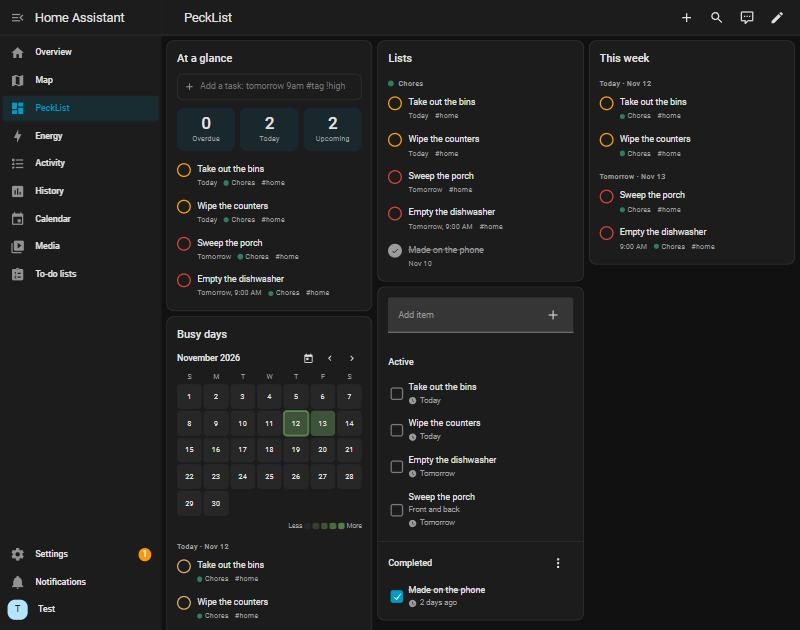
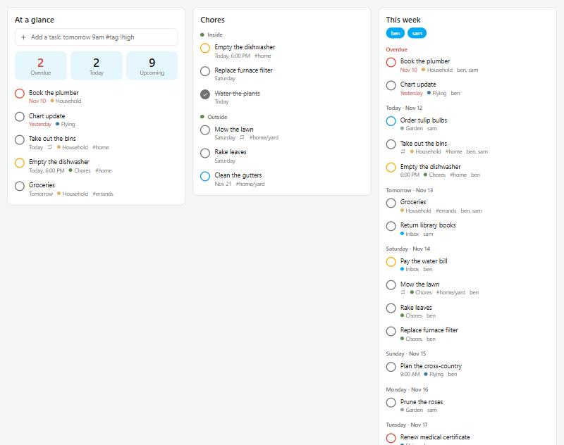
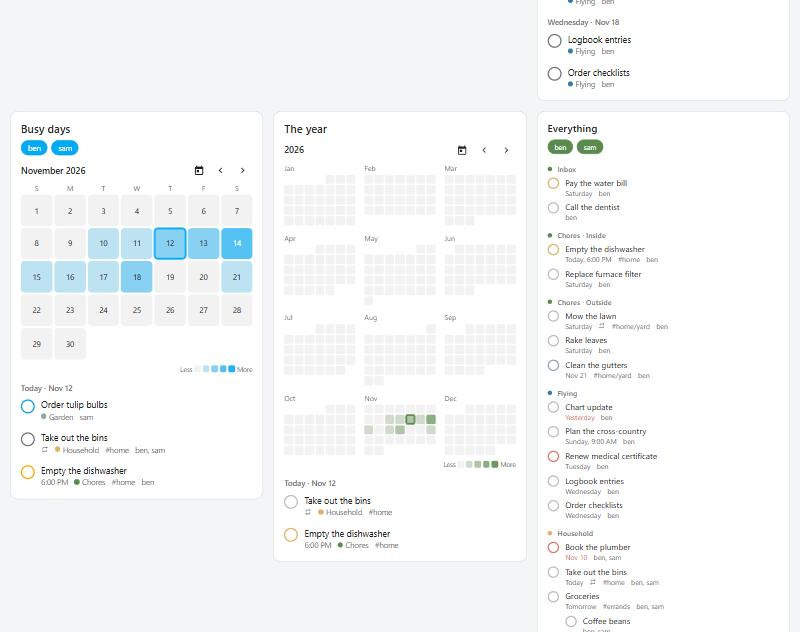
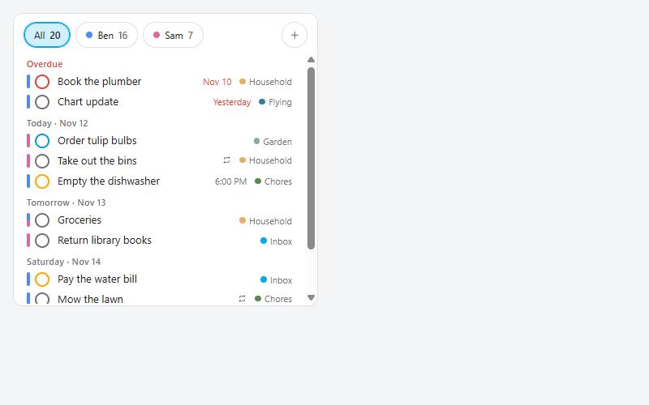
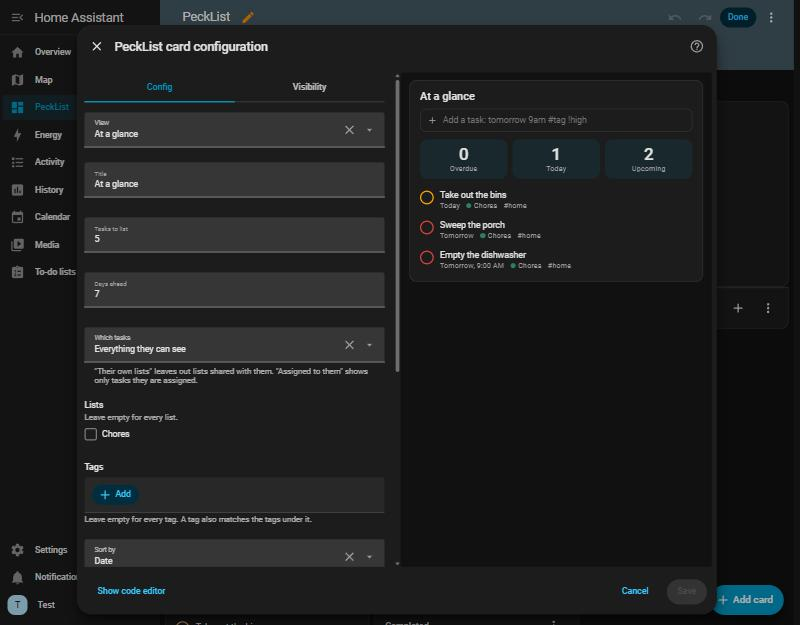
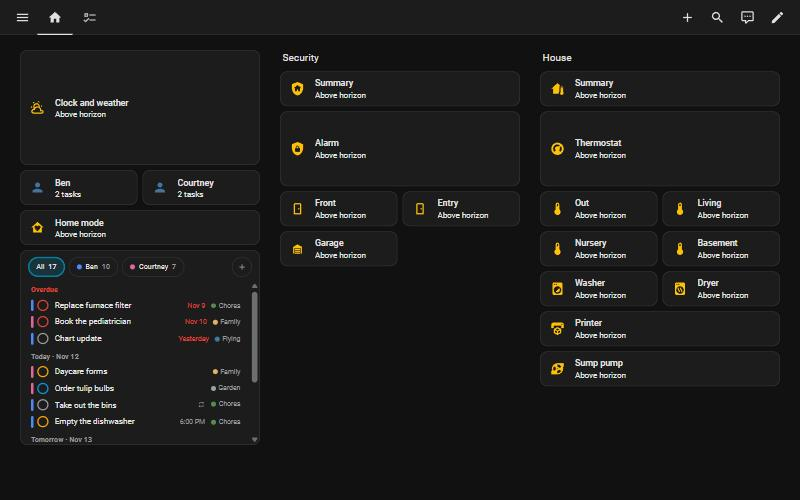

# PeckList card for Home Assistant

A dashboard card for [PeckList](https://pecklist.com) tasks: what is due at a glance, whole lists
with sections and subtasks, an agenda for the week, and a heatmap of busy days. Check tasks off,
add them with PeckList's quick add, and edit them, without leaving the dashboard.



It needs the [PeckList integration](https://github.com/KillSwitchIO/pecklist-home-assistant), which
holds the connection to your PeckList server. The card talks only to that integration, so no API
key ever reaches the browser.

## Install

1. Install and set up the [PeckList integration](https://github.com/KillSwitchIO/pecklist-home-assistant) first.
2. With [HACS](https://hacs.xyz): the three dots > **Custom repositories**, add
   `https://github.com/KillSwitchIO/pecklist-card` as a **Dashboard**, then download **PeckList
   Card**. HACS adds the dashboard resource for you.
3. Reload the browser, edit a dashboard, **Add card**, and pick **PeckList**.

By hand: put `pecklist-card.js` from the latest release in `config/www/`, and add
`/local/pecklist-card.js` as a JavaScript module under **Settings > Dashboards > Resources**.

## Views



| View | |
| --- | --- |
| **At a glance** | Counts for overdue, today and upcoming, and the next few tasks. Tap a count to see those tasks. |
| **List** | One or more lists, grouped by section, with subtasks under their parent. |
| **Agenda** | What is overdue, then today and the days ahead. |
| **Busy-day heatmap** | A month, or a year of small months, shaded by how many tasks fall on each day. Tap a day to see its tasks. |



In every view:

- tap the circle to complete a task, and again to reopen it. The circle's color is the priority;
- tap a task to change its title, date, time, priority, tags and notes, to assign it (in a shared
  list), or to delete it;
- a task assigned to someone who is not on the card says so: `@Sam`;
- with **Show the add box**, type a line the way you would in PeckList:
  `Pay rent tomorrow 9am #bills !high`.

Lists you may only view are shown but cannot be changed.

## Several people

Each person connects their own PeckList account in the integration. A card can show one person,
some, or everyone together.



With more than one person on a card:

- every person has a **color**, and a stripe at the left of each task says whose it is: the person
  it is assigned to, or everyone who can see it when nobody is assigned. A task in a shared list
  shows once, with a stripe in both colors;
- a row of **buttons**, **All** and one per person, each with that person's open count. Tap a name
  to see only their tasks; tap it again, or **All**, to go back;
- two lists with the same name (everyone has an Inbox) say whose they are.

Names come from Home Assistant when the account is matched to a user there, otherwise from
PeckList. Colors are given in the order the accounts were connected, the same on every card; to
choose your own, set `person_colors` in YAML with the integration entry's id:

```yaml
person_colors:
  01JC8R4V0ZB8Q4D9C2M7K1XJ5E: '#4C8BF5'
```

**Which tasks** decides what "their tasks" means:

- everything they can see;
- their own lists only, leaving out lists shared with them;
- only tasks assigned to them, for example in a shared Household list.

When the integration knows which Home Assistant user an account belongs to (its **Configure**
button), a card with no people chosen shows whoever is signed in their own tasks.

Everyone signed in to your Home Assistant can see every connected account's tasks, on this card and
in the integration's entities. Home Assistant cannot hide them per user.

## Options

The visual editor covers everything. In YAML:



```yaml
type: custom:pecklist-card
view: agenda
title: This week
entries: []          # the integration entries (people) to show
scope: assigned      # all | own | assigned
lists: []            # list ids; empty for every list
tags: [home]         # also matches home/yard
days: 7
quick_add: true
```

| Option | Default | |
| --- | --- | --- |
| `view` | `glance` | `glance`, `list`, `agenda` or `heatmap` |
| `title` | none | A heading for the card |
| `entries` | signed-in person, else everyone | Which people |
| `scope` | `all` | `all`, `own` or `assigned` |
| `lists` | every list | Only these lists |
| `tags` | every tag | Only tasks with these tags, or tags under them |
| `sort` | `date` | `date`, `priority`, `title`, `created`, or `manual` for the order you gave tasks in PeckList |
| `density` | `comfortable` | or `compact` |
| `colors` | `theme` | `theme` follows Home Assistant; `pecklist` uses PeckList's Forest palette |
| `person_colors` | built in | A color per person, by integration entry id |
| `show_completed` | `false` | Also show recently completed tasks |
| `quick_add` | `false` | Show the add box |
| `kiosk` | `false` | Wall tablet layout |
| `max_items` | `5` | At a glance: how many tasks to list |
| `days` | `7` | At a glance and agenda: how far ahead to look |
| `range` | `month` | Heatmap: `month` or `year` |
| `height` | grows to fit | A fixed height in pixels; the tasks scroll |

### Fitting a dashboard



Home Assistant's sections views give a card a cell: 12 columns wide inside its section, and rows
of about 56 pixels. The card fills whatever cell you give it (drag its corner in the dashboard
editor, or set `grid_options`), keeps its buttons in place, and scrolls its tasks inside.

For a small cell, such as the space under other tiles in a section, use `density: compact`:

- each task is one line, with its date and list at the right;
- the counts of the at-a-glance view shrink to one row;
- the add box folds behind a **+** button until you want it;
- in a narrow cell the list names give way to the task titles.

About five rows show seven tasks. A card given a whole screen, across two or three sections, lays
its groups out side by side instead of in one long column.

```yaml
type: custom:pecklist-card
view: agenda
density: compact
days: 2
quick_add: true
grid_options:
  columns: full
  rows: 5
```

### Wall tablet

`kiosk: true` makes everything large enough for a finger across the room, and nothing needs a
keyboard: the add box becomes one big button that opens Assist, listening. Say "add milk to
shopping" and Home Assistant adds it to that PeckList list.

## Dates

A task shows its due date when it has one, and its scheduled date otherwise; changing the date on
the card changes that same one. "Today" follows Home Assistant's time zone.

## Development

```bash
npm ci
npm run build && npm run lint && npm test
npm run demo        # dist/demo.html: the card over a stand-in for Home Assistant
```

The project is developed on GitLab:
[gitlab.com/killswitch10/pecklist-card](https://gitlab.com/killswitch10/pecklist-card). The GitHub
repository is a read-only mirror for HACS; please open issues and merge requests on GitLab.

## License

MIT. PeckList itself is licensed separately (AGPL-3.0-or-later).
